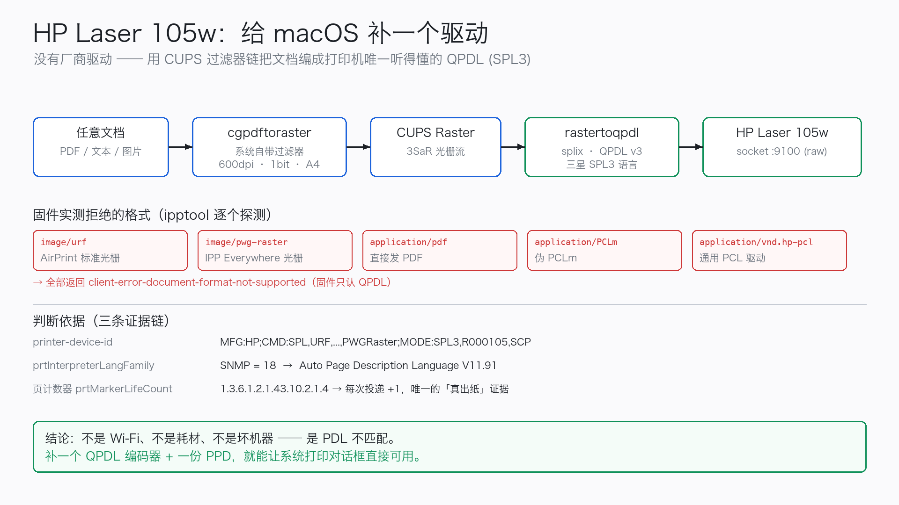

# hp105w-macos

**A working macOS print driver for the HP Laser 105w** — no HP software, no `HP Smart` detour.

> The Laser 105w is a Samsung-engine rebadge. Its firmware speaks only **SPL3 / QPDL**.
> macOS speaks PDF / URF / PWG-Raster, so jobs "complete" while nothing is rendered.
> This project adds the missing translator: encode to QPDL and push it straight to TCP 9100.



**中文**: [README.md](README.md)

---

## Quick start

```bash
git clone https://github.com/kvx07/hp105w-macos.git
cd hp105w-macos

make build      # fetch + compile the QPDL encoder (~30s)
make test       # self-test, no printer required

./bin/hp105w-print file.pdf     # print, no root needed
make install                    # add to the system print dialog (one sudo)
```

After `make install`, every app's ⌘P lists **HP Laser 105w (SPL/QPDL driver)**.

---

## Three ways to print

```bash
# 1. CLI
./bin/hp105w-print report.pdf
./bin/hp105w-print -w -c 2 a.pdf b.pdf   # -w waits and reports pages actually ejected

# 2. Drag & drop
make app                                  # builds HP105w-Print.app

# 3. System queue
make install
./scripts/install.sh 192.168.1.50         # explicit IP if discovery fails
```

Queue details: name `HP_Laser_105w_SPL`, URI `socket://<ip>:9100`,
filter `/usr/libexec/cups/filter/rastertoqpdl`. Remove with `make uninstall`.

---

## Pipeline

```
document (PDF / text / image)
   │  cupsfilter + PPD → system cgpdftoraster
   ▼
CUPS Raster  (600dpi · 1-bit · A4, stream magic "3SaR")
   │  rastertoqpdl → SpliX QPDL encoder
   ▼
QPDL / SPL3  (PJL header + banded compressed raster)
   │  TCP 9100 (JetDirect raw)
   ▼
HP Laser 105w → paper
```

Forensics and measurements: [docs/how-it-works.md](docs/how-it-works.md),
[docs/evidence/](docs/evidence/) (including the HP support engineer's
"not supported on macOS" reply, with exact URL / message id / timestamp).

---

## Why the usual fixes fail

| Approach | Failure mode |
|---|---|
| AirPrint / IPP Everywhere | firmware never advertises `urf-supported`; `image/urf`, `image/pwg-raster`, `application/pdf` all return `client-error-document-format-not-supported` |
| Generic PCL driver | `device-id` has no PCL5/6 — job is dropped silently, no error reported |
| HP Smart | only prints from inside its own app; system print path stays dead |
| Waiting for an official driver | HP support states the model isn't supported on macOS (2025-10) |

Probe matrix: [docs/evidence/02-format-probe.txt](docs/evidence/02-format-probe.txt)

---

## Diagnostics

```bash
./scripts/diagnose.sh            # network / IPP / supplies / queue / page counter
./scripts/diagnose.sh --probe    # additionally probe which PDLs the firmware accepts
```

| Symptom | Fix |
|---|---|
| `cannot reach <ip>:9100` | DHCP moved the printer. Re-run `./scripts/install.sh` (auto-discovers) |
| system queue silent | `ls -l /usr/libexec/cups/filter/rastertoqpdl` must be `root wheel 0755`; re-run `make install` |
| blank pages | raster came out empty — try `-n` to inspect output size; print-to-PDF first |
| banding / garbage | change `*QPDL BandSize: "128"` to `64` or `256` in the PPD, re-install |
| ~10s per page | normal, laser fuser warm-up |

---

## Compatibility

| Model | Status |
|---|---|
| HP Laser 105w | ✅ verified (macOS 26 / 27, firmware V3.82.05.16) |
| HP Laser 105a / 105 / 107 (same SPL3 engine) | 🟡 expected to work, untested |
| HP Laser 100 / M17w family | 🟡 try if `device-id` contains `SPL` |

Check with `./scripts/diagnose.sh` → look for `SPL3` in `printer-device-id`.

---

## License

**GPL-2.0** — the project links against and redistributes [SpliX](https://github.com/OpenPrinting/splix)'s
`rastertoqpdl` / `pstoqpdl` (GPLv2), and the PPD derives from its `ml2160.ppd`.
`scripts/build.sh` fetches and builds SpliX from upstream; see [LICENSE](LICENSE).

Trademarks belong to their owners. Not affiliated with HP or Samsung.
