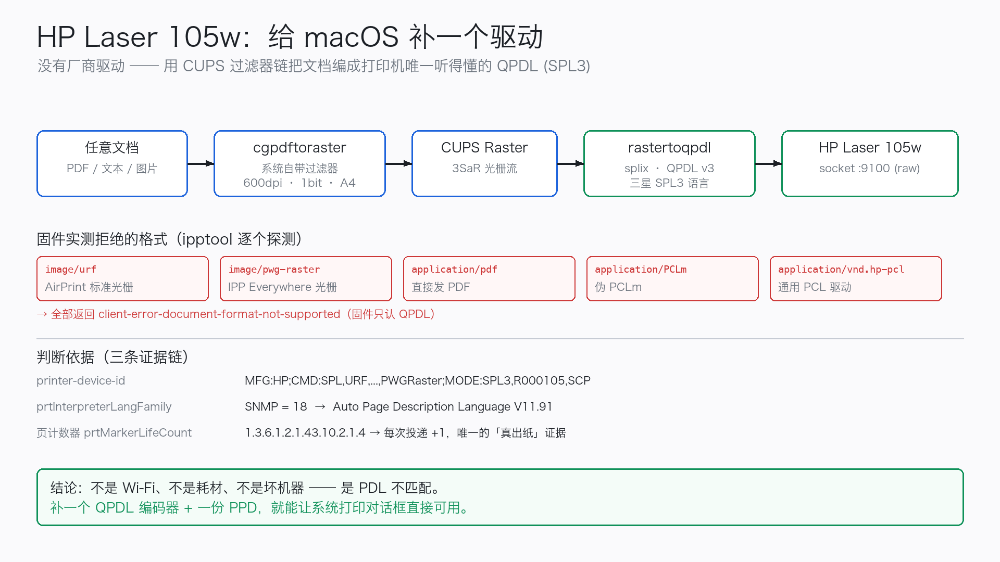

# hp105w-macos

**HP Laser 105w 在 macOS 上的开箱即用打印驱动** —— 不依赖 HP 任何官方软件，也不需要 `HP Smart` 中转。

> 这台机器是三星（Samsung）机芯的换壳机，固件只认 **SPL3 / QPDL**。
> macOS 只会发 PDF / URF / PWG-Raster，于是任务"提交成功"但一个字都打不出来。
> 本项目补上缺失的那一环：把文档编成 QPDL，直接灌进打印机的 9100 端口。



**English**: [README.en.md](README.en.md)

---

## 30 秒上手

```bash
git clone https://github.com/kvx07/hp105w-macos.git
cd hp105w-macos

make build      # 下载并编译 QPDL 编码器（约 30 秒）
make test       # 自检，不需要打印机

./bin/hp105w-print 你的文件.pdf     # 直接打（无需 root）
make install                        # 装进系统打印对话框（要一次管理员密码）
```

装完之后，任何 App 的 ⌘P 里都能选到 **HP Laser 105w (SPL/QPDL driver)**。

---

## 三种用法

### 1. 命令行（最轻，零配置）

```bash
./bin/hp105w-print 报告.pdf
./bin/hp105w-print -w -c 2 合同.pdf 发票.pdf   # -w 打完报告实际出纸页数
./bin/hp105w-print -n 论文.pdf                 # 只转换不打印，用于调试
```

### 2. 拖拽打印

```bash
make app        # 生成 HP105w-Print.app
```
把 PDF / 文本 / 图片拖到它身上即可。可以拖进「应用程序」或程序坞。

### 3. 系统打印队列（推荐日常使用）

```bash
make install                     # 自动发现打印机
./scripts/install.sh 192.168.x.x # 或显式指定 IP
```

装出来的是普通 CUPS 队列：

| 项 | 值 |
|---|---|
| 队列名 | `HP_Laser_105w_SPL` |
| 设备 URI | `socket://<打印机IP>:9100` |
| 过滤器 | `/usr/libexec/cups/filter/rastertoqpdl` |
| PPD | `ppd/HP_Laser_105w.ppd` |

卸载：`make uninstall`

---

## 它到底做了什么

```
文档 (PDF/文本/图片)
   │  cupsfilter + PPD → 系统自带 cgpdftoraster
   ▼
CUPS Raster  (600dpi · 1bit · A4，流头 "3SaR")
   │  rastertoqpdl  → SpliX 的 QPDL 编码器
   ▼
QPDL / SPL3 数据  (PJL 头 + 分带压缩光栅)
   │  TCP 9100 (JetDirect raw)
   ▼
HP Laser 105w  →  出纸
```

细节与取证过程见 [docs/how-it-works.md](docs/how-it-works.md)
和 [docs/evidence/](docs/evidence/)（含 HP 官方"不支持 macOS"的原文出处）。

---

## 为什么不用现成的办法

| 方案 | 为什么不行 |
|---|---|
| macOS 自动发现（AirPrint / IPP Everywhere） | 固件不回 `urf-supported`，`image/urf`、`image/pwg-raster`、`application/pdf` 全部返回 `client-error-document-format-not-supported` |
| 通用 PCL 驱动 | device-id 里没有 PCL5/PCL6，收到 PCL 直接丢弃，且**不报错** |
| HP Smart | 只能在其 App 内"转移文件后打印"，系统通道依旧不可用 |
| 等官方驱动 | HP 支持工程师 2025-10 明确回复：该机型不支持 macOS（原文见 evidence） |

实测矩阵：[docs/evidence/02-format-probe.txt](docs/evidence/02-format-probe.txt)

---

## 体检与排错

```bash
./scripts/diagnose.sh            # 网络 / IPP / 耗材 / 队列 / 页计数器
./scripts/diagnose.sh --probe    # 额外逐格式探测固件接受度
```

常见问题：

| 现象 | 处理 |
|---|---|
| `连不上 <IP>:9100` | 打印机 DHCP 换了 IP。重新 `./scripts/install.sh`（不带参数会自动发现） |
| 系统队列没反应 | `ls -l /usr/libexec/cups/filter/rastertoqpdl` 应为 `root wheel 0755`；否则重跑 `make install` |
| 打出空白页 | 源文件光栅化为空。`./bin/hp105w-print -n 文件` 看产物大小；先用「打印到 PDF」再打 |
| 条带 / 乱码 | 改 `ppd/HP_Laser_105w.ppd` 里 `*QPDL BandSize: "128"` 为 `64` 或 `256`，重新 `make install` |
| 一页要等十几秒 | 正常。激光机预热定影；连续任务会快 |

---

## 兼容性

| 机型 | 状态 |
|---|---|
| HP Laser 105w | ✅ 实测通过（macOS 26 / 27，firmware V3.82.05.16） |
| HP Laser 105a / 105 / 107（同三星 SPL3 机芯） | 🟡 预期可用，未实测 —— 欢迎反馈 |
| HP Laser 100 / M17w 等 | 🟡 若 device-id 含 `SPL` 可试；本项目的 PPD 来自同族 ml2160 |

判断方法：`./scripts/diagnose.sh` 里看 `printer-device-id` 是否含 `SPL3`。

---

## 项目结构

```
bin/hp105w-print        命令行驱动（含自动发现、页计数校验）
scripts/build.sh        下载并编译 SpliX、生成 PPD
scripts/install.sh      装成 CUPS 队列
scripts/uninstall.sh    卸载
scripts/diagnose.sh     取证式体检
scripts/make-app.sh     生成拖拽 .app
ppd/                    队列 PPD（QPDL v3 / BandSize 128 / A4 / 600dpi）
app/                    拖拽 App 的 AppleScript 源
docs/                   原理、证据、架构图
tests/smoke.sh          不需要打印机的自检
```

---

## 许可

**GPL-2.0**。原因：本项目链入并分发 [SpliX](https://github.com/OpenPrinting/splix) 的
`rastertoqpdl` / `pstoqpdl`（GPLv2），PPD 亦由其 `ml2160.ppd` 派生。
源码由 `scripts/build.sh` 从上游拉取并编译，许可证全文见 [LICENSE](LICENSE)。

自用无任何限制；再分发二进制时请一并提供源码（`build/` 里的原始 tarball 即可）。

商标归属各自所有者；本项目与 HP、Samsung 无隶属关系。
